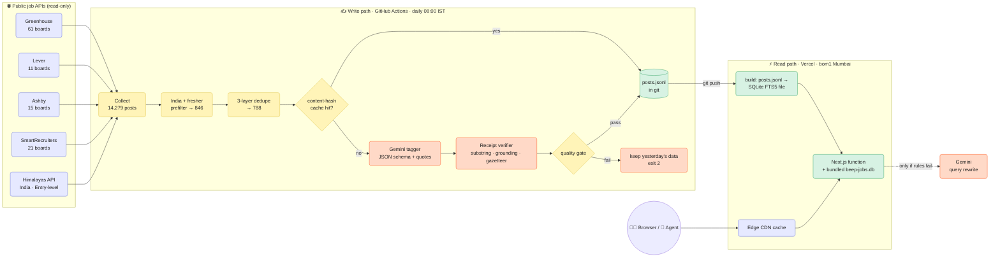
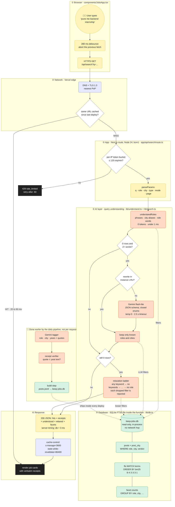
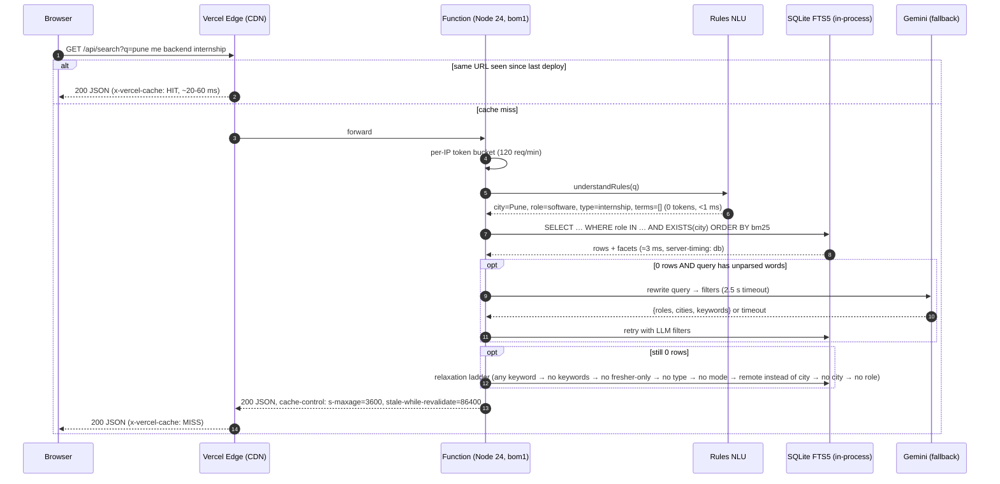
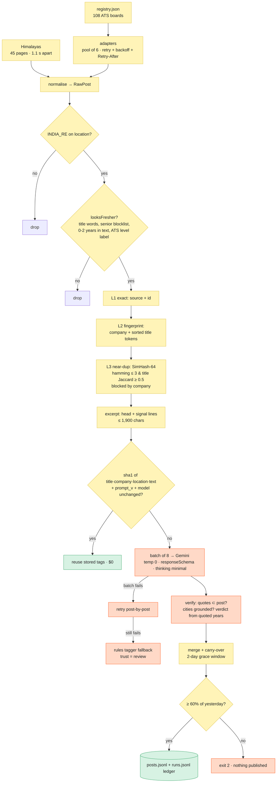
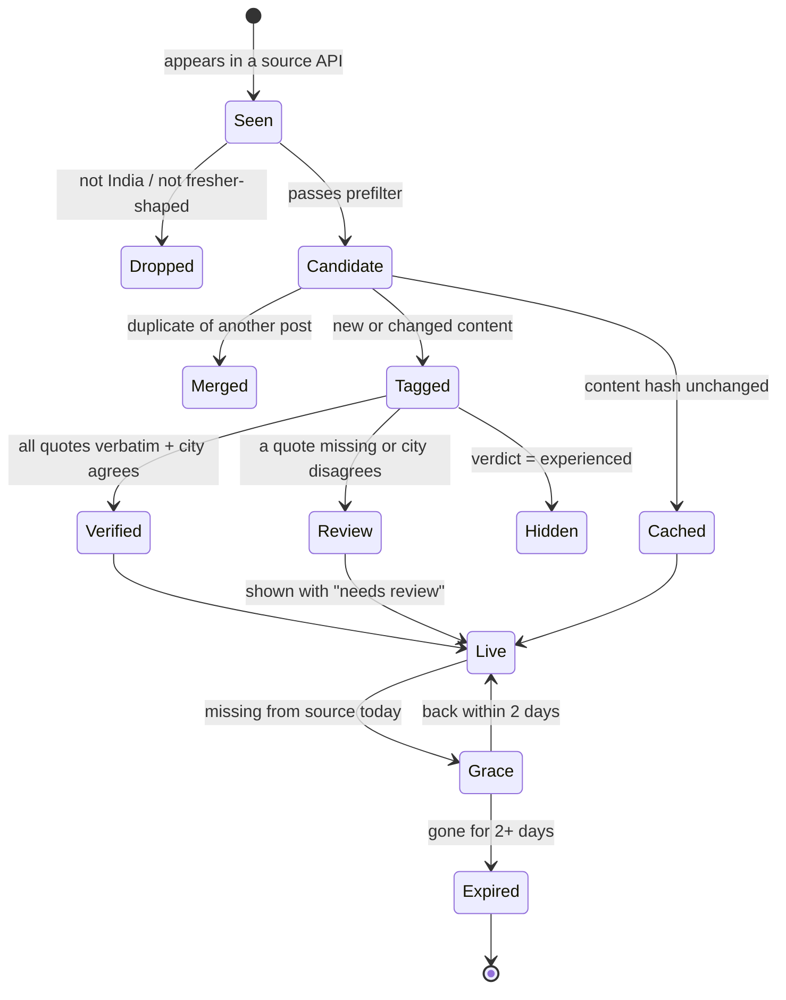
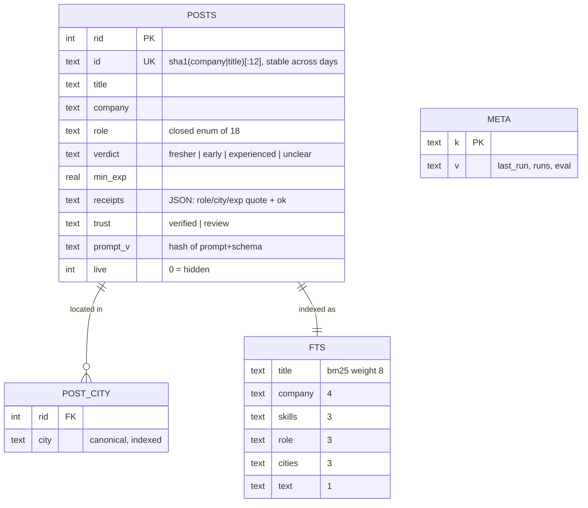
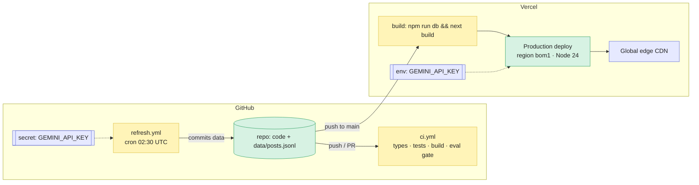

<div align="center">

# beep-jobs

### Fresher jobs in India, tagged by AI, **with receipts.**

Every role, city and "fresher" tag comes with a **verbatim quote from the job post** that proves it.
Plain code checks that the quote is really in the post. **No quote, no tag.**

**[Live site: beep-jobs.vercel.app](https://beep-jobs.vercel.app)** · [Search jobs](https://beep-jobs.vercel.app/jobs) · [Accuracy](https://beep-jobs.vercel.app/evals) · [AI view (`/llms.txt`)](https://beep-jobs.vercel.app/llms.txt)


</div>

---

## TL;DR: the two numbers that were asked for

| | Result | How it was measured |
|---|---|---|
| **Tagging accuracy** | **Role 98%** (95% CI 93–99%; one-label 90%) · **City 95%** (89–98%) · **Role and city both right 93%** · Fresher verdict 96% | **100 posts** labelled **blind** (labels written before the model was run on them), on a **held-out set drawn and labelled after the prompt was final**. Seeded draw, half first-party ATS and half aggregator posts. Rules in [`docs/LABELING.md`](docs/LABELING.md). Every post and every miss is public on [`/evals`](https://beep-jobs.vercel.app/evals). |
| **Cost per 1,000 posts** | **$0.54** (production run) | Real token counts from Gemini `usageMetadata` × Google's list price. Production run: 695 posts, 333,947 input + 109,081 output tokens = **$0.3729**. Re-tagging an unchanged post costs **$0** (content-hash cache), so a normal day costs cents. |

Rules-only baseline on the same posts: role 56%. **The LLM adds 42 points of role accuracy for about half a US cent per post.**

One honest caveat: on **city**, the plain rules (a gazetteer over the location field) scored **97%** on this set, slightly above the AI's 95%. Most held-out posts are remote roles whose location field is clean, which is exactly where rules shine. The AI earns its cost on role (+42 points) and on the fresher verdict (96% vs 88%), and the city tag already uses the gazetteer as a second check.

**Known misses on the held-out set** (left unfixed on purpose: fixing them would turn the held-out set into dev data):
- 3 verdicts one band off: "up to 2 years" read as early instead of fresher, and two posts that ask for "2+ years" (one also says "3 to 6 years") read as experienced.
- 3 location lists like "Remote (Afghanistan, Armenia, …)" tagged `Pan-India` instead of `Remote`.
- 2 cities named only in the description (training in New Delhi, an Ahmedabad office) that the grounding rule removed.
- 2 roles: an SAP topic page with no real duties, and an open "Discipline Undecided" engineering-design track tagged as software.

**Run-to-run noise.** The CI eval gate re-ran the same held-out set with the same prompt on 2026-11-17 and scored role 98%, city 97%, role and city 95%, verdict 95% (79/83), cost $0.57 per 1,000. Gemini at temperature 0 is not bit-exact, so treat about ±2 points as noise. The headline numbers above are from the first run, not the better one.

### What changed between v1 and v2 of the tagger

| | v1 (`20f64852`) | v2 (`04ee401a`) |
|---|---|---|
| Held-out set | 50 posts | **100 new posts**, never seen during tuning |
| Role | 94% (84–98) | **98%** (93–99%) |
| City | 96% (87–99) | **95%** (89–98%) |
| Role and city both right | 92% | **93%** |
| Fresher verdict | 94% | **96%** |

The v1 held-out set was used to find v2's fixes, so it became dev data. Reporting v2 on it would be grading our own homework. v2 is scored on a fresh set instead. The fixes were general rules, not per-post patches:

1. **City grounding (code).** A city must appear in the location field or in the verified city quote. This removed cities the model inferred from a company's head office on remote jobs, and stray "Other" tags next to a real city.
2. **Verdict policy in code.** The model extracts the minimum years; code applies the written rule (0 is fresher, up to 2 is early, more than 2 is experienced). A verified quote that states years overrides the model's own number, so "2+ years" can no longer be read as "experienced".
3. **Clearer role rules.** Collections calling, trading support, web design, interpreting and AI-data gig work each got one written tie-break, shared by the prompt and the [labelling guide](docs/LABELING.md).
4. **One labelling guide.** The two v1 sets had labelled AI-data gig work in opposite ways. The guide settles it, and every changed label is logged with its rule.

---

## The hero feature: Receipts

Thousands of people are building "scrape jobs, add LLM tags, show a search page". Every one of those boards asks users to **trust the AI**. beep-jobs is built on the opposite idea: **an AI tag is a claim, and a claim needs evidence.**

```text
┌──────────────────────────────────────────┐
│ BEEP-JOBS · TAG RECEIPT         #07A67D8D │
│ Social Media Intern · SWIGGY              │
│- - - - - - - - - - - - - - - - - - - - - -│
│ ROLE   Marketing, Content & Growth        │
│ ▌"Social Media Management: Assist in      │
│ ▌ managing Dineout Mag's social media…"  ✓│
│ CITY   Mumbai                             │
│ ▌"Mumbai, MH, India"                     ✓│
│ FRESHER?  True fresher · 0 yrs            │
│ ▌"relevant internship experience is      ✓│
│ ▌ welcome."                               │
│- - - - - - - - - - - - - - - - - - - - - -│
│ TRUST  VERIFIED · all quotes match        │
│ ||||| |||| | ||||| || |||| ||| | |||| ||  │
└──────────────────────────────────────────┘
```

How it works:

1. The LLM must return **a verbatim quote for each tag** (role, city, experience), enforced by a JSON schema.
2. **Deterministic code** checks each quote is a real substring of the post (after whitespace and quote normalisation). A hallucinated quote fails.
3. Code then **grounds** the tags in those quotes: cities must be named in the location or the quote, and the fresher verdict is computed from the years the quote states.
4. A second, **LLM-independent signal**, a city gazetteer over the structured location field, must agree with what the model said.
5. Only posts that pass all checks get `trust: verified`. Everything else is shown as "needs review".

Across all 300 evidence quotes in the held-out run, **300 were found verbatim**.

### Three more things other boards don't have

| Feature | What it does | Why it matters |
|---|---|---|
| **Fake-fresher detector** | Reads the *requirements*, not the title, and gives each post a verdict: `fresher` / `early` / `experienced` / `unclear`, with the quote. `experienced` posts are hidden and listed on a public [hidden-posts page](https://beep-jobs.vercel.app/jobs?rejected=1). | 49 posts are hidden today. 21 of them came from a feed already filtered to "Entry-level" by the job board itself, yet ask for more than 2 years. |
| **Hinglish search with a cost cascade** | `pune me backend internship chahiye` becomes `city=Pune, role=Software, type=internship`, parsed by **rules at 0 tokens**. The LLM is called only when rules fail, with a 2.5 s timeout, and the CDN caches the answer. A relaxation ladder (remote instead of your city, then no city, then no role) means a search never ends on an empty page, and the page says exactly what it relaxed. | Most searches cost $0 and answer in milliseconds. If Gemini is down, search still works. |
| **Human \| AI toggle** | One click turns the landing page into a structured, skill-shaped markdown file (frontmatter, when-to-use, tool specs, schema, rules for agents). Also served at [`/llms.txt`](https://beep-jobs.vercel.app/llms.txt). | AI agents are a second audience. beep-jobs is a job board an agent can use correctly. |

---

## System at a glance



**The core design decision:** the write path (expensive, slow, LLM-heavy, once a day) and the read path (cheap, fast, many times a second) **share nothing but a git commit.** The read path never calls a database server; the database is a small file shipped inside each function.

---

## Request flow: browser → AI → database

One search, end to end. Each frame is one layer, and each sticky note is one real step in the code.
Solid arrows are control flow. Dotted arrows are SQL queries into the database, and the daily build that ships it.



**How to read it**

- **AI runs at two times.** At request time it only turns the user's words into filters (④). At pipeline time it reads every post and writes the tags and receipts (🌙). So the search itself never waits on a model to read job posts.
- **The LLM is the second choice, not the first.** Rules handle most queries for 0 tokens. Gemini is called only when rules find 0 rows for a query of 2+ words, and a 2.5 s timeout means a slow model never blocks the page.
- **The database is a file, not a server.** Every function instance opens its own read-only copy of `beep-jobs.db`. There is no connection pool to exhaust and no network call to the data.

---

## Runtime topology: how one request travels



---

## Write path: the daily pipeline (LLD)



### Post lifecycle



### Data model



---

## The AI-native parts, in detail

| Concern | Decision | Why |
|---|---|---|
| Output shape | Gemini `responseSchema` with **closed enums** for role (18), city (33) and verdict (4) | The model cannot invent "Bangalore" vs "Bengaluru" or a new role. Normalisation is free. |
| Field order | `propertyOrdering` puts each `*_quote` **before** its label | The model commits to evidence first, then labels from it. A cheap chain-of-thought with no extra tokens. |
| Hallucination control | Verbatim-quote check, city grounding, gazetteer cross-check | Turns invisible errors into a visible `review` flag, and removes unsupported cities outright. |
| Model extracts, code decides | The model returns the minimum years with a quote; `verdictFor()` applies the policy | The policy lives in one tested function instead of in the model's reading of "2+ years". |
| Token diet | `excerpt()` keeps the first ~650 chars plus every line that mentions years, location, stipend, degree, etc. | Requirements often sit 3,000 chars deep under a company blurb. ~450 input tokens per post. |
| Batching | 8 posts per call, 3 calls in flight | Amortises the system prompt. Batch failure falls back to single-post calls, then to rules. |
| Determinism | temperature 0, `thinkingLevel: minimal` | Reproducible tags; thinking tokens are billed as output and add nothing on this task. |
| Prompt as code | `PROMPT_V = sha1(prompt + schema)` stored on every tag | Any prompt change invalidates the cache and is traceable on `/evals`. |
| Evals as CI | `ci.yml` re-runs the held-out eval when `pipeline/tagger/**`, the taxonomy or golden files change, and fails below 80% role / 85% city | A prompt "improvement" that regresses can't ship. |
| Honest evaluation | **Dev** set (100, tuned on) and a **held-out** set (100, labelled after tuning, never tuned on). Wilson 95% intervals. One-label and two-label role scores. A written labelling guide with an adjudication log. | The dev number is optimistic by construction; only the held-out number is quoted. |
| Query understanding | rules → LLM → relaxation ladder | 0-token path for most queries; LLM only where it adds value; never an empty page. |

---

## Scalability, reliability, availability

### Why this design scales

| Load | What happens | Bottleneck | Answer |
|---|---|---|---|
| 1 → 10k req/s reads | CDN absorbs repeat queries; misses hit stateless functions, each with its own in-process SQLite | none shared | Functions scale horizontally; there is **no DB server to saturate** and no connection pool. |
| 700 → 100k posts | Pipeline time grows linearly; FTS5 file grows to ~500 MB | function bundle size (250 MB limit) | Move the index to Turso/libSQL replicas or Postgres + pg_trgm read replicas; the write/read contract (one artifact per day) stays the same. |
| Tagging cost at 100k new posts/day | $0.54 × 100 ≈ **$54/day**; about half with Gemini Batch API | LLM spend | Content-hash cache means only *new or changed* posts cost money; most days most posts are unchanged. |
| More sources | Add a slug to `registry.json` or a 20-line adapter | upstream politeness | Bounded concurrency per source, Retry-After honoured, failures isolated per board. |

### Failure modes and what the user sees

| Failure | Detection | Behaviour |
|---|---|---|
| A board 404s or times out | adapter catch, per-board | That board is skipped; others continue. |
| A whole source fails (>50% boards error) | `failedSources` | Its posts from yesterday are carried over, not expired. |
| Gemini 429 / 5xx | HTTP status | Exponential backoff + jitter (5 tries) → single-post retry → rules fallback with `trust: review`. The run never fails because of the LLM. |
| `GEMINI_API_KEY` missing in the cron | startup check | Exit 3 before tagging, so a whole day of rules-only tags never replaces good data by accident. |
| Model returns garbage or invents a quote | schema + `verify()` | Post marked `review`, visible to users. |
| Pipeline yields < 60% of yesterday's posts | quality gate | Exit 2, nothing committed; **yesterday's site stays live**. |
| Refresh did not land for 36 h | `/api/health` → `stale: true` | Point an uptime monitor at it; site keeps serving the last good data. |
| Vercel build fails | Vercel keeps the previous deployment | No downtime: immutable deploys, atomic switch. |
| Search LLM fallback down | 2.5 s timeout | Rules result returned; search is never blocked on the LLM. |
| Abuse of the LLM fallback | per-IP token bucket + CDN cache | 429 after 120 req/min per instance. |

**Availability story:** the read path has exactly one runtime dependency, the Vercel platform. No database, no queue, no cache cluster and no LLM is required to serve a search. Data is versioned in git, so any bad day can be reverted with `git revert` and a redeploy.

---

## Deployment topology



- **Region `bom1` (Mumbai)**: the users are in India.
- **Concurrency group** on the refresh job: two writers can never race.
- **Immutable deploys**: every data refresh is a new deploy; the CDN cache is invalidated atomically.

---

## Design

The site is a light, plain page for reading job posts, with one loud object: the thermal-paper receipt. Headings use **Anek Latin** (Ek Type, Mumbai) at a condensed width; reading text uses **Golos Text**. Monospace is reserved for one meaning: text copied word for word from a job post. The receipts band on the landing page is the only dark surface. Motion is limited to three moments: the receipt printing on load, the receipt highlights, and the funnel bars drawing once.

---

## Engineering decisions (short ADRs)

1. **SQLite FTS5 baked into the deploy instead of Postgres/Elasticsearch.** Data changes once a day and is a few MB. A file read beats any network hop, costs $0 and cannot go down separately. Revisit at ~100k posts.
2. **Git as the system of record.** Every daily snapshot is diffable, reviewable and revertible; the run ledger (`data/runs.jsonl`) is an audit log of cost and quality.
3. **Public APIs only.** Slower to reach volume than scraping, but nothing breaks when a site changes its HTML, and nothing violates anyone's terms. See [`docs/COMPLIANCE.md`](docs/COMPLIANCE.md).
4. **`gemini-3.5-flash-lite` over a bigger model.** Held-out 98% role / 95% city at $0.54 per 1,000. A bigger model would need to beat that by enough to justify ~2.5× the price; the eval harness makes that a one-command experiment (`BEEP_JOBS_MODEL=… npm run eval`).
5. **Closed taxonomy, 18 roles.** Fine enough to be useful for a fresher, coarse enough that two people mostly agree.
6. **Policy in code, perception in the model.** The model reads and quotes; code applies thresholds. Changing "fresher means up to 2 years" is a one-line, unit-tested change, not a prompt rewrite.
7. **No Batch API.** It halves cost but adds up to hours of latency to a daily job and a second code path. Worth it only at much larger volume.

---

## Run it yourself

```bash
git clone https://github.com/vinitpatil519/beep-jobs && cd beep-jobs
npm ci
cp .env.example .env              # add GEMINI_API_KEY
npm run pipeline                  # collect → dedupe → tag → verify → data/posts.jsonl
npm run eval -- holdout           # score the tagger on the held-out posts
npm test                          # unit tests (dedupe, receipts, verdict policy, NLU, prefilter)
npm run dev                       # http://localhost:3000
```

| Command | What it does |
|---|---|
| `npm run pipeline` | Full daily refresh; idempotent; second run on the same day costs $0. |
| `npm run eval -- holdout` / `-- dev` | Accuracy + cost on a golden set, writes `data/eval-*.json`, exits 1 below the gate. |
| `GOLDEN_N=100 npm run golden:sample -- <seed> <exclude files…>` | Reproducible stratified sample for new labels. |
| `npm run db` | Build `data/beep-jobs.db` from `posts.jsonl`. |

## Repository layout

```
pipeline/
  sources/        public API adapters + board registry
  dedupe.ts       exact → fingerprint → SimHash
  tagger/         prompt, schema, Gemini client, verifier, verdict policy, rules fallback
  run.ts          daily orchestrator + quality gate + ledger
  eval.ts         golden-set scoring with Wilson CIs and rules baseline
  build-db.ts     posts.jsonl → SQLite FTS5
lib/              search, query understanding cascade, taxonomy, agent markdown
app/              Next.js: landing (/), jobs (/jobs), accuracy (/evals), APIs, /llms.txt
components/       Landing (GSAP + Lenis), JobsApp, Receipt
data/             posts.jsonl, runs.jsonl, golden.{dev,holdout}.jsonl, eval-*.json
docs/             COMPLIANCE.md, LABELING.md
```

## Honest limitations

- **Who labelled the golden sets.** The labels were written by an AI assistant reading each post blind (without seeing model output), following [`docs/LABELING.md`](docs/LABELING.md). No second person has checked them, so agreement between labellers is unmeasured. A human pass over `data/golden.holdout.jsonl` is the first thing to do next.
- **n = 100.** Read the 95% intervals, not only the point estimates.
- **Source mix.** Most live posts come from the Himalayas API (remote roles open to India). First-party ATS boards add city-specific roles; adding more Indian company boards to `registry.json` is the cheapest way to grow city coverage.
- **"Remote" is a city.** It is a pseudo-city in the taxonomy so remote jobs are filterable alongside real cities.

---

<div align="center">
<sub>Built with Next.js 16, GSAP, Lenis, node:sqlite FTS5, Gemini and GitHub Actions. Jobs data from public APIs of Greenhouse, Lever, Ashby, SmartRecruiters and <a href="https://himalayas.app">Himalayas</a>.</sub>
</div>
